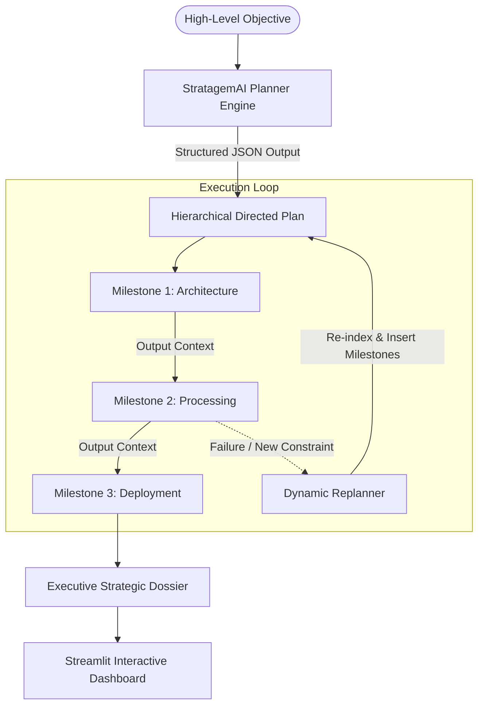

# StratagemAI - Autonomous AI Planner & Goal Decomposition Engine

[](https://python.org)
[](https://streamlit.io)
[](https://langchain.com)
[](https://pydantic.dev)
[](https://opensource.org/licenses/MIT)

**StratagemAI** is a goal-oriented planning engine implementing the **Plan-and-Solve** and **Hierarchical Planning** paradigm in Python. Rather than single-turn generation or uncoordinated tool calling, StratagemAI decomposes complex, ambiguous goals into topologically sorted milestones, coordinates execution across specialized agent personas, and dynamically re-plans when faced with environment shifts or failure states.

---

## Strategic Workflow



---

## Core Capabilities

- **Hierarchical Goal Decomposition:** Breaks ambiguous requests into discrete, dependency-mapped milestones with assigned personas (e.g. Lead Architect, Data Engineer, QA Lead).
- **Dependency-Aware Execution:** Enforces prerequisite rules—subtasks will not execute unless prerequisite parent tasks have completed.
- **Context Synthesis Across Steps:** Each step's output is injected into the prompt context for subsequent milestones, maintaining deep continuity.
- **Dynamic Replanning Engine:** Handles runtime exceptions or shifting scope by modifying remaining tasks and logging an audit trail of changes.
- **Dossier & Schema Export:** Instant download of the full plan in Markdown or Pydantic JSON.
- **Zero-Key Demo Blueprints:** Out-of-the-box support for pre-baked enterprise pipelines.

---

## Quick Start

### 1. Installation
```bash
git clone https://github.com/<your-username>/StratagemAI.git
cd StratagemAI
pip install -r requirements.txt
```

### 2. Configure Environment
```bash
cp .env.example .env
```

### 3. Launch Application
```bash
streamlit run app.py
```

---

## Comprehensive Documentation
For formal state machine definitions, algorithmic breakdowns, and benchmark traces, refer to [Project Documentation](docs/Project_Documentation.md).

---

## License
MIT License. Open for educational and commercial development.
