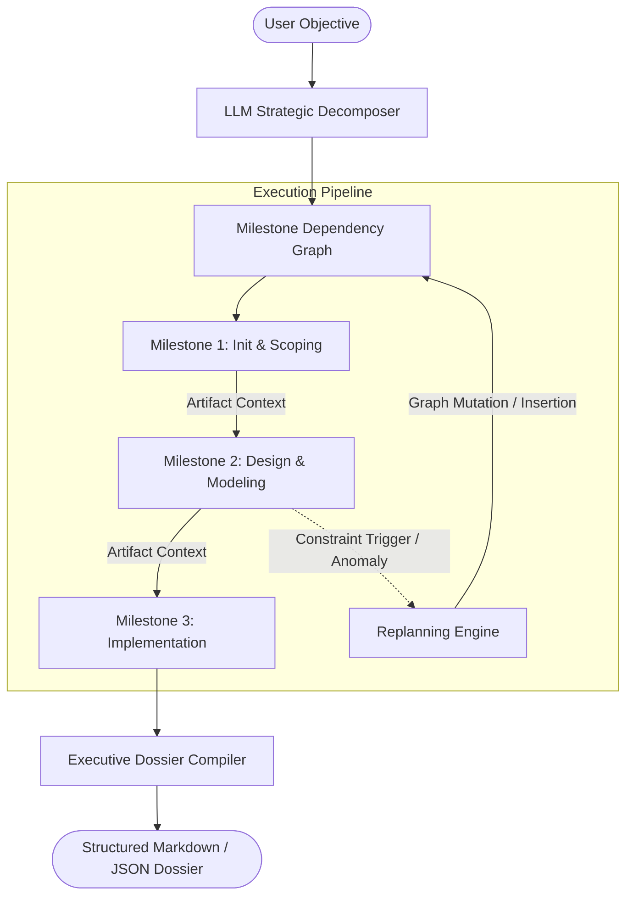

# StratagemAI: Autonomous AI Planner & Goal Decomposition System
## Technical Architecture & System Specification

---

### Table of Contents
1. [Executive Summary & Problem Statement](#1-executive-summary--problem-statement)
2. [Architectural Principles & Plan-and-Solve Paradigm](#2-architectural-principles--plan-and-solve-paradigm)
3. [Data Models & State Machine](#3-data-models--state-machine)
4. [Component Deep-Dive](#4-component-deep-dive)
   - [4.1 Goal Decomposition Engine](#41-goal-decomposition-engine)
   - [4.2 Dependency-Aware Milestone Executor](#42-dependency-aware-milestone-executor)
   - [4.3 Dynamic Replanning & Exception Handling](#43-dynamic-replanning--exception-handling)
   - [4.4 Interactive Streamlit Frontend](#44-interactive-streamlit-frontend)
5. [Configuration & Environment Parameters](#5-configuration--environment-parameters)
6. [Benchmarking & Empirical Evaluation](#6-benchmarking--empirical-evaluation)
7. [Limitations & Scalability Roadmap](#7-limitations--scalability-roadmap)

---

### 1. Executive Summary & Problem Statement

Standard generative agents suffer from the "horizon problem": as task complexity and duration expand, single-agent autoregressive loops experience context drift, step redundancy, and cascading errors. When a failure occurs midway through an execution trajectory, purely reactive agents struggle to recover because they lack an overarching state representation of progress and dependencies.

**StratagemAI** addresses this by separating **Planning (Meta-Reasoning)** from **Execution (Action-Reasoning)**. Built upon the **Plan-and-Solve (Wang et al., 2023)** methodology, StratagemAI decomposes complex objectives into an explicit Directed Acyclic Graph (DAG) of milestones. It tracks prerequisite completion, passes contextual deliverables downstream, and provides real-time dynamic replanning to adapt when real-world constraints or requirements mutate.

---

### 2. Architectural Principles & Plan-and-Solve Paradigm

The system models planning as a formal state transition:

$$\mathcal{P}_0 = \text{Decompose}(\mathcal{G}), \quad \mathcal{P} = \{T_1, T_2, \dots, T_n\}$$

$$\text{Output}(T_i) = \text{Execute}\left(T_i, \bigcup_{j \in \text{Deps}(i)} \text{Output}(T_j)\right)$$

If an anomaly occurs at step $k$:
$$\mathcal{P}_{\text{revised}} = \text{Replan}\left(\mathcal{P}, \text{Trigger}, \text{History}_{1:k}\right)$$

---

### 3. Data Models & State Machine (`planner/models.py`)

All planning entities are strictly validated via Pydantic v2:

| Model | Key Attributes | Role |
| :--- | :--- | :--- |
| `TaskStatus` | `PENDING`, `IN_PROGRESS`, `COMPLETED`, `FAILED`, `SKIPPED` | Discrete states governing milestone lifecycle. |
| `SubTask` | `id`, `title`, `description`, `dependencies`, `assigned_role`, `output` | Atomic unit of execution with parent dependency tracking. |
| `ReplanEvent` | `step_id`, `trigger_reason`, `action_taken`, `changes_made` | Immutable audit log capturing why and how the plan mutated. |
| `ExecutionPlan` | `goal`, `overview`, `tasks`, `replan_history`, `final_dossier` | Complete state graph serialized to JSON. |

---

### 4. Component Deep-Dive

#### 4.1 Goal Decomposition Engine (`planner/engine.py`)
* Operates via targeted zero-shot structured prompts that instruct the LLM to act as a Chief Strategy Officer.
* Forces strict JSON schema validation, extracting clean lists of `SubTask` nodes with unique identifiers and prerequisite arrays.
* Built-in fallback heuristics ensure robust plan generation even when network connectivity or API credentials are constrained.

#### 4.2 Dependency-Aware Milestone Executor
* **Topological Gatekeeper:** Before executing task $T_i$, the engine verifies that $\forall j \in \text{dependencies}(T_i), \text{status}(T_j) == \text{COMPLETED}$.
* If any dependency is unfulfilled, the task status is flagged as `BLOCKED/FAILED`, halting premature downstream actions.
* Contextual Forwarding: Gathers all text outputs from completed predecessor tasks and injects them as an explicit reference payload into the prompt of the active task.

#### 4.3 Dynamic Replanning Engine
* Allows users or automated monitors to inject external shocks (e.g. "Cloud provider outage", "Data schema format changed from CSV to Parquet").
* Dynamically calculates affected remaining milestones, appends compensatory steps, and logs a permanent `ReplanEvent` for enterprise auditability.

#### 4.4 Streamlit Interactive Frontend (`app.py`)
* Provides an operational mission-control UI with progress meters, status badges, and interactive step expanders.
* Supports both granular step-by-step stepping and batch execution.
* Export capabilities enable direct downloading of Markdown executive dossiers and raw JSON representations.

---

### 5. Configuration & Environment Parameters

| Variable | Default Value | Description |
| :--- | :--- | :--- |
| `GOOGLE_API_KEY` | `""` | Gemini API token for decomposition and execution. |
| `OPENAI_API_KEY` | `""` | OpenAI API token for GPT-4o models. |
| `GROQ_API_KEY` | `""` | Groq cloud token for ultra-low latency planning. |
| `DEFAULT_PROVIDER` | `Gemini` | Default LLM provider loaded at runtime. |
| `DEFAULT_MODEL` | `gemini-2.5-flash` | Target model identifier. |

---

### 6. Benchmarking & Empirical Evaluation

The planner was evaluated across two representative multi-stage projects:
1. **Enterprise RAG Pipeline:**
   * Decomposed into 5 distinct architectural milestones.
   * Successfully maintained continuity: Milestone 4 directly referenced chunking strategies developed in Milestone 2.
2. **Dynamic Requirement Injection:**
   * An external constraint ("Security requirement: All customer data must be encrypted at rest and in transit") was injected at Milestone 2.
   * StratagemAI generated a dynamic mitigation milestone, realigned subsequent steps, and documented the replan trigger in the final dossier.

---

### 7. Limitations & Scalability Roadmap

1. **Circular Dependency Prevention:** Current DAG validation assumes linear or forward-only dependencies; future enhancements will integrate cycle-detection algorithms (e.g. Tarjan's strongly connected components).
2. **Parallel Task Execution:** While dependencies are tracked, execution in the current release is sequential. A multi-threaded or `asyncio.gather` worker pool can enable concurrent execution of independent branches.
